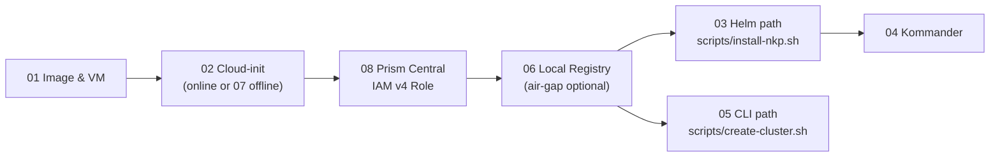

# Lab 12 — Ubuntu bootstrap machine and NKP 2.19 install

**Learn:** how to paste a Prism Central cloud-init that builds an Ubuntu jump host, and how to install a
**self-managed NKP 2.19** cluster by either path from `nkp-deployer`.



Cloud-init clones this repository (or unpacks the offline bundle) and copies **this folder** to
`/home/ubuntu/nkp-workspace` on the VM. Both install scripts are in that copy.

## Quick run

Helm path (kind bootstrap, chart, pivot), from `nkp-infra-tf`:

```bash
cd /home/ubuntu/nkp-workspace
cp env.example env
cp values.example.yaml values.local.yaml
./scripts/install-nkp.sh
```

CLI path (`nkp create cluster nutanix --self-managed`), from
`nkp-deployer/install/management-cluster/traditional/nkp-installer.sh`:

```bash
cd /home/ubuntu/nkp-workspace
cp create-cluster.env.example create-cluster.env
./scripts/create-cluster.sh
```

Use one path for a given cluster name.

## Steps

| # | Step | What you do |
|---|---|---|
| 01 | [Image and VM](steps/01-image-and-vm.md) | download the Ubuntu qcow2, size the VM, set the Prism name |
| 02 | [Cloud-init](steps/02-cloud-init.md) | paste `cloud-init.yaml`, set the password and SSH key |
| 08 | [Prism Central role](steps/08-prism-central-role.md) | create or update the least-privileged NKP 2.19 IAM v4 role & Authorization Policy (`create-prism-role.ps1` / `.py`) |
| 06 | [Air gap and registry](steps/06-airgap-registry.md) | *(optional / air-gapped)* download the 33 GB bundle and run a TLS registry the cluster trusts |
| 07 | [Offline bootstrap](steps/07-offline-bootstrap.md) | *(optional / no internet VM)* get the CI bundle on a client, push it, install from it |
| 03 | [Helm path](steps/03-install-cluster.md) | fill `values.local.yaml` and run `scripts/install-nkp.sh` |
| 04 | [Kommander](steps/04-kommander.md) | turn on `INSTALL_KOMMANDER` and the Docker Hub secret |
| 05 | [`nkp create cluster`](steps/05-create-cluster.md) | fill `create-cluster.env` and run `scripts/create-cluster.sh` |

## Updating scripts & rollback (Auto-Update v2)

All update paths preserve your local `env`, `values.local.yaml`, `create-cluster.env`, kubeconfigs,
`airgap/`, and registry certs:

- **Online jump host (`nkp-update`):**
  - `nkp-update --status` — show installed commit/release version and rollback availability
  - `nkp-update --check` — check if a newer release is available without modifying files
  - `nkp-update` — download latest release tarball (or `main`), back up current scripts to `/var/backups/nkp-workspace/prev`, update `nkp-workspace` and `/usr/local/lib/nkp-bootstrap/`, and enforce `chmod +x` on `*.sh` and `*.py`
  - `nkp-update --from-tarball /path/to/nkp-labs-update.tar.gz` — offline update on an air-gapped jump host
  - `nkp-update --rollback` — restore the previous backup
  - `nkp-update --rerun` — re-run `bootstrap-host.sh` after updating
- **Push from a workstation to an air-gapped jump host:**
  - Linux/macOS: `./scripts/update-bastion.sh ubuntu@<bastion-ip>` (`--dry-run`, `--rollback`)
  - Windows PowerShell: `.\scripts\update-bastion.ps1 -Target ubuntu@<bastion-ip>` (`-DryRun`, `-Rollback`)
  - Downloads the SHA-256 verified `nkp-labs-update.tar.gz` once, transfers a single tarball over SSH/SCP, verifies checksum, backs up previous scripts, updates `nkp-workspace` + `/usr/local/lib/nkp-bootstrap/`, and sets `+x` on `*.sh` and `*.py`.
- **Standalone Prism Central role scripts:**
  - Windows PowerShell: `.\create-prism-role.ps1 -CheckUpdate` / `-SelfUpdate`
  - Linux/macOS: `./scripts/create-prism-role.py --check-update` / `--self-update`

## Files

| File | What |
|---|---|
| `versions.env` | single source of truth for NKP, kubectl, Helm, Flux, k9s, yq, and `registry:2` versions (sourced by `bootstrap-host.sh`, checked by CI) |
| `cloud-init.yaml` | Prism guest customization. A loader for `nkp-bootstrap.service` that downloads the latest `scripts/bootstrap-host.sh` on every run. `nkp-bootstrap-status` shows progress |
| `scripts/bootstrap-host.sh` | the host install: packages, disk grow, Docker, CLIs, workspace, registry image. Resumes after a failure or a restart |
| `scripts/update-workspace.sh` | `nkp-update` on the VM (`--status`, `--check`, `--from-tarball`, `--rollback`, `--rerun`). Never overwrites local env/config/kubeconfig files |
| `scripts/expand-root-disk.sh` | grows the root partition or LV. Safe to run again |
| `cloud-init-offline.yaml` | the same paste with `NKP_MODE=offline`: no internet on the VM. Generated by `scripts/make-offline-cloud-init.sh` |
| `scripts/get-offline-bundle.sh` | client: download the latest CI offline bundle (or build it here). `get-offline-bundle.ps1` is the same command for Windows PowerShell |
| `scripts/build-offline-bundle.sh` | client or CI: installers, Ubuntu packages, `registry:2`, lab snapshot in one tarball |
| `scripts/push-offline-bundle.sh` | client: copy the bundle (and optionally the air-gapped bundle) to the VM and start the install |
| `scripts/verify-offline-bundle.sh` | install a bundle in a container with no network (CI runs it) |
| `env.example` | installer knobs (`CLUSTER_NAME`, `EXPECTED`, `INSTALL_KOMMANDER`). Copy to `env` |
| `values.example.yaml` | NKP cluster values. Copy to `values.local.yaml` (gitignored) |
| `scripts/install-nkp.sh` | Helm path: `nkp create bootstrap`, chart, kubeconfig, pivot, optional Kommander |
| `create-cluster.env.example` | CLI path values. Copy to `create-cluster.env` (gitignored) |
| `scripts/create-cluster.sh` | CLI path: `nkp create cluster nutanix --self-managed` (auto-detects air-gap bootstrap tar, patches CoreDNS & `/etc/hosts`) |
| `scripts/preflight.sh` | 5-second fail-fast check before `create-cluster.sh` (env, disk, registry TLS + pushed bundles, VIP conflicts, Prism objects) |
| `scripts/push-airgap-bundles.sh` | idempotent air-gap helper: extracts the 33 GB bundle if needed and pushes `konvoy` + `kommander` bundles to the local registry |
| `scripts/post-install-info.sh` | Day-0 handoff summary: nodes, CAPI status, CoreDNS check, Flux `HelmRelease` health, Kommander URL/credentials, workstation hosts entry |
| `scripts/cleanup-bootstrap.sh` | safely removes stuck kind bootstrap containers after a failed install without touching `nkp-registry`, `airgap/`, or env files |
| `scripts/fetch-airgap-bundle.sh` | download the 2.19.1 air-gapped bundle (~33 GiB). Resumes, checks the size, writes `.complete`. Run by `nkp-airgap-download.service`. Log: `/var/log/nkp-bootstrap.log` |
| `scripts/setup-local-registry.sh` | self-signed CA, registry certificate, `registry:2` on this host (bcrypt auth + Docker CA trust by host and IP) |
| `scripts/trust-registry.sh` | Opaque Secret `username` / `password` / `ca.crt` for CAREN |
| `scripts/create-prism-role.ps1` | Windows PowerShell 5.1+/7+: creates or updates in-place the NKP 2.19 master Prism Central IAM v4 role (294 ops + correlated `View` safeguard + recursive `relatedOperationList`) and Authorization Policy, with `-CheckUpdate`/`-SelfUpdate` and optional 8-endpoint live check. Guide: [08](steps/08-prism-central-role.md) |
| `scripts/create-prism-role.py` | Linux/macOS Python 3 equivalent of `create-prism-role.ps1`, with `--check-update`/`--self-update`. Guide: [08](steps/08-prism-central-role.md) |
| `scripts/update-bastion.sh` | Linux/macOS: SHA-256 verified tarball update to an air-gapped bastion (`--dry-run`, `--rollback`) without touching local env/registry/airgap data |
| `scripts/update-bastion.ps1` | Windows PowerShell equivalent of `update-bastion.sh` (`-DryRun`, `-Rollback`) |
| `tests/test_prism_role.py` | 7-scenario local HTTPS mock test suite for `create-prism-role.py` and `create-prism-role.ps1` (runs in CI) |
| `tests/test_repo_hygiene.py` | Repo hygiene checks: Markdown links, `+x` & LF line endings, `versions.env` sync, `render.sh` YAML validation (runs in CI) |
| `helm-charts/nkp-cluster/` | `NKPCluster` plus Prism secrets |
| `helm-charts/nkp-kommander/` | Kommander installer ConfigMap and the Docker Hub secret |

## Variables (`env`)

| Variable | Meaning | Example |
|---|---|---|
| `CLUSTER_NAME` | management cluster name | `nkp-mgmt` |
| `NAMESPACE` | NKP namespace | `kommander` |
| `EXPECTED` | control-plane replicas + worker replicas | `5` |
| `BOOTSTRAP_TIMEOUT` | `nkp create bootstrap` timeout | `20m` |
| `SKIP_PIVOT` | stop after the kubeconfig | `false` |
| `INSTALL_KOMMANDER` | continue with the Kommander chart | `false` |
| `INSTALL_TIMEOUT` | `nkp install kommander` wait | `1h` |

`values.local.yaml` holds Prism, the node SSH key, CIDRs, VIPs, and the NKP node image name. An empty
`sshPublicKey` stops the script before it creates the kind bootstrap cluster.

## URLs

| What | URL |
|---|---|
| This lab | https://github.com/fernandoquinino-ntx/nkp-labs/tree/main/12-bootstrap-machine |
| Offline bundle release & `MANIFEST.json` | https://github.com/fernandoquinino-ntx/nkp-labs/releases/tag/offline-bundle |
| Prism Central role script (Windows PS1) | https://github.com/fernandoquinino-ntx/nkp-labs/releases/download/offline-bundle/create-prism-role.ps1 |
| Prism Central role script (Linux/macOS Python) | https://github.com/fernandoquinino-ntx/nkp-labs/releases/download/offline-bundle/create-prism-role.py |
| Cloud-init (raw, paste into Prism) | https://raw.githubusercontent.com/fernandoquinino-ntx/nkp-labs/main/12-bootstrap-machine/cloud-init.yaml |
| Cloud-init offline (raw) | https://raw.githubusercontent.com/fernandoquinino-ntx/nkp-labs/main/12-bootstrap-machine/cloud-init-offline.yaml |
| Ubuntu 24.04 amd64 cloud image | https://cloud-images.ubuntu.com/noble/current/noble-server-cloudimg-amd64.img |
| NKP 2.19.1 CLI (linux amd64) | https://downloads.d2iq.com/dkp/v2.19.1/nkp_v2.19.1_linux_amd64.tar.gz |
| kubectl v1.36.2 (linux amd64) | https://dl.k8s.io/release/v1.36.2/bin/linux/amd64/kubectl |
| Helm v3.22.1 (linux amd64) | https://get.helm.sh/helm-v3.22.1-linux-amd64.tar.gz |
| Flux v2.10.0 (linux amd64) | https://github.com/fluxcd/flux2/releases/download/v2.10.0/flux_2.10.0_linux_amd64.tar.gz |
| k9s v0.51.0 (linux amd64) | https://github.com/derailed/k9s/releases/download/v0.51.0/k9s_Linux_amd64.tar.gz |
| yq v4.47.1 (linux amd64) | https://github.com/mikefarah/yq/releases/download/v4.47.1/yq_linux_amd64 |
| Docker Engine (Ubuntu) | https://download.docker.com/linux/ubuntu |
| NKP 2.19 release note | https://next.nutanix.com/product-updates/nutanix-kubernetes-platform-nkp-2-19-45966 |
| NKP 2.19.1 air-gapped bundle | https://downloads.d2iq.com/dkp/v2.19.1/nkp-air-gapped-bundle_v2.19.1_linux_amd64.tar.gz |

NKP **2.19.1** keeps Kubernetes **1.36.2** (1.35.x is still supported). The public CLI archive is
**linux amd64** only. sha256 of `nkp_v2.19.1_linux_amd64.tar.gz`:
`3d311ecb1848eadfd9e749f1ed4b451f0f16b63679fd537d62763051b396f770`.

**Next:** [01 — image and VM](steps/01-image-and-vm.md).
