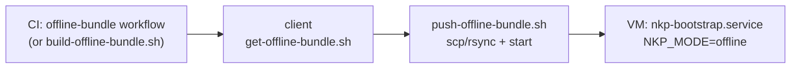

# 07 — Offline bootstrap (no internet on the VM)

The VM gets a password, SSH, and the bootstrap service from cloud-init, like step 02. Everything
else comes from one bundle that you download on a client machine and push to the VM.



## 1. Paste the offline cloud-init

Paste [`cloud-init-offline.yaml`](../cloud-init-offline.yaml) as in [02](02-cloud-init.md). Edit only
the hostname, the `ubuntu` password, and your SSH key. It is `cloud-init.yaml` with
`NKP_MODE=offline`, generated by `scripts/make-offline-cloud-init.sh`. CI fails if the two drift.
The CI artifact includes a copy next to the bundle.

https://raw.githubusercontent.com/fernandoquinino-ntx/nkp-labs/main/12-bootstrap-machine/cloud-init-offline.yaml

Nothing in it reaches the internet. cloud-init does not run `apt update` (`package_update: false`).
The VM boots with SSH and the password, then logs
`waiting for nkp-bootstrap-offline-*.tar.gz in /home/ubuntu` once a minute until the bundle arrives.
CI runs the loader and `/etc/default/nkp-bootstrap` from this file against the bundle with
`--network none`.

## 2. Get the bundle on the client (one command)

```bash
git clone https://github.com/fernandoquinino-ntx/nkp-labs.git && cd nkp-labs/12-bootstrap-machine
./scripts/get-offline-bundle.sh
```

Windows PowerShell (same download and the same sha256 check):

```powershell
git clone https://github.com/fernandoquinino-ntx/nkp-labs.git; cd nkp-labs\12-bootstrap-machine
winget install GitHub.cli
gh auth login
powershell -ExecutionPolicy Bypass -File .\scripts\get-offline-bundle.ps1
```

The script downloads the latest successful build of the
[`offline-bundle` workflow](https://github.com/fernandoquinino-ntx/nkp-labs/actions/workflows/offline-bundle.yml)
with `gh` (run `gh auth login` first) and checks its sha256. Without `gh` or a CI build it runs
`build-offline-bundle.sh` here, which needs Docker. The result is
`dist/nkp-bootstrap-offline-v2.19.1-noble-amd64.tar.gz` (about 0.6 GiB).

CI builds a new bundle on every push to `12-bootstrap-machine/`, so the bundle always carries the
latest scripts. Before uploading, CI installs the bundle in an Ubuntu 24.04 container with
`--network none`. A bundle that needs the internet fails the build.

| Folder in the bundle | What |
|---|---|
| `downloads/` | nkp v2.19.1 (sha256 checked), kubectl v1.36.2, Helm v3.22.1, Flux v2.10.0, k9s v0.51.0, yq v4.47.1 |
| `debs/` | apt repository: the Ubuntu 24.04 packages, Docker CE, and every dependency |
| `images/registry-2.tar` | `registry:2` for [06](06-airgap-registry.md) |
| `labs/` | this lab at the built commit (committed files only, no secrets) |
| `MANIFEST.txt`, `SHA256SUMS` | versions, commit, checksums of every file |

## 3. Push it and start the install

```bash
./scripts/push-offline-bundle.sh dist/nkp-bootstrap-offline-v2.19.1-noble-amd64.tar.gz ubuntu@<vm-ip> --follow
```

- The password is asked once (one shared SSH connection). `SSHPASS=... ` with `sshpass` skips the prompt.
- The copy uses rsync with resume when both sides have it, else scp. It retries 5 times. Run the
  same command again after a drop.
- The file lands as `.part` and is renamed when complete, so the VM never unpacks half a file.
- The VM checks every file against `SHA256SUMS`, unpacks to `/opt/nkp-offline`, and runs the same
  steps as online: apt from the local repository, Docker, the CLIs, the workspace, `docker load`.
- `--follow` tails `/var/log/nkp-bootstrap.log`. Ctrl-C stops watching, not the install.

Add the 33 GiB air-gapped bundle in the same push. It resumes and is marked complete when the size
matches:

```bash
./scripts/push-offline-bundle.sh dist/nkp-bootstrap-offline-v2.19.1-noble-amd64.tar.gz ubuntu@<vm-ip> \
  --airgap ~/Downloads/nkp-air-gapped-bundle_v2.19.1_linux_amd64.tar.gz --follow
```

## Update after a fix

Push the fix to git, wait for the workflow, then run steps 2 and 3 again. The new bundle replaces
the old one, finished steps are skipped, and the workspace is refreshed from the new bundle.
Your `env`, `values.local.yaml`, `create-cluster.env`, kubeconfigs, `registry/` and `airgap/` stay.

## Build it yourself

```bash
./scripts/build-offline-bundle.sh              # needs Docker; downloads resume from dist/.cache
./scripts/verify-offline-bundle.sh dist/nkp-bootstrap-offline-v2.19.1-noble-amd64.tar.gz
```

On an Apple Silicon Mac, Docker runs the amd64 Ubuntu container under emulation. That is slower but
it works. Uncommitted changes are not in the bundle (it uses `git archive HEAD`).

The bundle holds the NKP CLI. Workflow artifacts on a public repository can be downloaded by any
signed-in GitHub user. Make the repository private if that matters for your licence.

**Back:** [06 — air gap and registry](06-airgap-registry.md).
