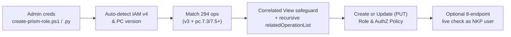

# 08 — Prism Central Role & Authorization Policy for NKP 2.19

Create — or **update in-place** — a least-privileged master **Prism Central IAM v4 custom role** and
its **Full-Access Authorization Policy** for an existing NKP user.

The same credential works across the full NKP lifecycle:

- **Management Cluster** deployment and **self-upgrades** (`UpgradePlan`, rolling nodes, categories,
  disks, NICs, images)
- **Managed (Workload) Clusters** deployment and lifecycle (CLI and NKP UI Infrastructure Provider)
- **CAREN** preflight webhooks, **CAPX v1.10**, **CCM**, **Nutanix IPAM**
- **Nutanix CSI 3.9** (Volumes block storage, hypervisor-attached disks, snapshots/clones, and
  **Files Storage** RWX dynamic NFS shares)
- **Nutanix Image Builder (NIB)** (`nkp create image nutanix`), **VM Affinity / Anti-Affinity
  Policies**, **GPU / PCIe**, **Flow Virtual Networking / Flow CNI / Flow Network Security (FNS)**,
  and **Metro / DR**



---

## Prerequisites

1. **Target NKP user already exists** in Prism Central (**Admin Center → IAM → Users**, Local or
   AD/LDAP, status `ACTIVE`). The script does **not** create users and never prints or saves
   passwords.
2. **Prism Central administrator credentials** (for example `admin`) to create/update the Role and
   Authorization Policy.
3. **Single Authorization Policy per NKP user** (per Nutanix **KB-20042**): avoid assigning the same
   NKP user to multiple conflicting Authorization Policies.

---

## Option A — Windows PowerShell (`create-prism-role.ps1`)

Works on **Windows PowerShell 5.1** and **PowerShell 7+**. Handles TLS 1.2 and self-signed Prism
Central certificates automatically.

### 1. Download and run interactively (recommended)

You do not need `git` installed — download directly from the public `offline-bundle` release:

```powershell
Invoke-WebRequest -UseBasicParsing `
  -Uri "https://github.com/fernandoquinino-ntx/nkp-labs/releases/download/offline-bundle/create-prism-role.ps1" `
  -OutFile .\create-prism-role.ps1

powershell -ExecutionPolicy Bypass -File .\create-prism-role.ps1
```

The script prompts for:

- **Prism Central IP** (e.g. `10.0.0.10` or `https://10.0.0.10:9440`)
- **Role name** (default: `NKP Cluster Create`)
- **NKP user** (must already exist in Prism Central)
- **Prism Central admin user** (default: `admin`) and **password** (masked input)

### 2. Run with live NKP user verification (`-NkpPassword`)

Pass `-NkpPassword` so the script immediately tests **8 critical NKP API endpoints** authenticated as
the NKP user right after creating/updating the role:

```powershell
powershell -ExecutionPolicy Bypass -File .\create-prism-role.ps1 `
  -PrismIp "10.0.0.10" `
  -RoleName "NKP Cluster Create" `
  -NkpUser "nkp-service-user" `
  -AdminUser "admin" `
  -NkpPassword "<nkp-user-password>"
```

*(You will still be prompted securely for the admin password unless `-AdminPassword` is also
passed.)*

### 3. Dry-run preview (`-PrintOnly`)

Inspect every matched direct permission, auto-added correlated `View` permission, and recursively
resolved `relatedOperationList` predecessor **without modifying anything** on Prism Central:

```powershell
powershell -ExecutionPolicy Bypass -File .\create-prism-role.ps1 `
  -PrismIp "10.0.0.10" `
  -AdminUser "admin" `
  -PrintOnly
```

### PowerShell parameters

| Parameter | Default | Description |
|---|---|---|
| `-PrismIp` | *(prompted)* | Prism Central IP, hostname, or URL (`:9440` added automatically if omitted) |
| `-RoleName` | `NKP Cluster Create` | Custom role name; policy is named `<RoleName> policy` |
| `-NkpUser` | *(prompted)* | Existing Prism Central username to bind in the Authorization Policy |
| `-AdminUser` | `admin` | Prism Central admin username |
| `-AdminPassword` | *(secure prompt)* | Admin password (never printed or saved) |
| `-NkpPassword` | *(omitted)* | Optional NKP user password to run the 8-endpoint live API self-test |
| `-PcVersion` | `auto` | Override Prism Central version detection (`auto`, `7.6`, `7.5`, `7.3`, `2024.3`) |
| `-ApiVersion` | `auto` | Override IAM v4 API version (`v4.0`, `v4.1`, `v4.1.b3`, `v4.0.b1`, ...) |
| `-PrintOnly` | `$false` | Dry-run: list matched + auto-resolved operations without creating/updating anything |
| `-CheckUpdate` | `$false` | Check the public `offline-bundle` release version, backward compatibility (up to 3 previous versions), and SHA-256 |
| `-SelfUpdate` | `$false` | Verify 3-version backward compatibility, SHA-256, and PowerShell syntax, back up `.bak`, and replace atomically |
| `-Force` | `$false` | Override the 3-previous-versions backward-compatibility guard during `-SelfUpdate` (SHA-256 and syntax checks remain mandatory) |

---

## Option B — Linux / macOS / Bastion (`create-prism-role.py`)

Uses Python 3 standard library only (no `pip install` needed).

### 1. Create or update the role and Authorization Policy

```bash
cd 12-bootstrap-machine
PRISM_ENDPOINT="https://10.0.0.10:9440" \
PRISM_USER="admin" \
PRISM_PASSWORD='<admin-password>' \
NKP_PC_USER="nkp-service-user" \
NKP_ROLE_NAME="NKP Cluster Create" \
./scripts/create-prism-role.py
```

### 2. Run with live 8-endpoint NKP user verification

Add `NKP_PC_PASSWORD`:

```bash
PRISM_ENDPOINT="https://10.0.0.10:9440" \
PRISM_USER="admin" \
PRISM_PASSWORD='<admin-password>' \
NKP_PC_USER="nkp-service-user" \
NKP_PC_PASSWORD='<nkp-user-password>' \
./scripts/create-prism-role.py
```

### 3. Dry-run preview (`--print`)

```bash
PRISM_ENDPOINT="https://10.0.0.10:9440" \
PRISM_USER="admin" \
PRISM_PASSWORD='<admin-password>' \
./scripts/create-prism-role.py --print
```

### Python environment variables

| Variable | Default | Description |
|---|---|---|
| `PRISM_ENDPOINT` | *(required)* | Prism Central IP, hostname, or URL |
| `PRISM_USER` | *(required)* | Prism Central admin username |
| `PRISM_PASSWORD` | *(required)* | Prism Central admin password |
| `NKP_PC_USER` | *(required unless `--print`)* | Existing Prism Central user for NKP |
| `NKP_PC_PASSWORD` | *(optional)* | Enables the 8-endpoint live API verification as `NKP_PC_USER` |
| `NKP_ROLE_NAME` | `NKP Cluster Create` | Custom role name |
| `NKP_POLICY_NAME` | `<NKP_ROLE_NAME> policy` | Authorization Policy name |
| `PRISM_PC_VERSION` | *(auto-detected)* | Override PC version (`7.5`, `7.3`, `2024.3`, ...) |
| `PRISM_IAM_VERSION` | *(auto-detected)* | Override IAM API version (`v4.0`, `v4.1.b3`, `v4.0.b1`, ...) |
| `PRISM_INSECURE` | `true` | Skip TLS verification for self-signed PC certs (`false` to enforce) |

---

## Self-Updating the Standalone Script (SHA-256 & 3-Version Compatibility)

If you downloaded `create-prism-role.ps1` or `create-prism-role.py` directly without cloning the
repository, you can check for updates and self-update safely in place. Both scripts:

1. Compare the installed script version against `lab_version` in the release `MANIFEST.json` and
   explicitly report whether the upgrade is **`BACKWARD-COMPATIBLE`** (up to 3 previous minor
   versions behind) or **`NOT BACKWARD-COMPATIBLE`** (blocked unless `-Force` / `--force` is passed).
2. Verify the downloaded SHA-256 digest and validate syntax before replacing (saving a `.bak` copy).

```powershell
# Windows PowerShell
powershell -ExecutionPolicy Bypass -File .\create-prism-role.ps1 -CheckUpdate
powershell -ExecutionPolicy Bypass -File .\create-prism-role.ps1 -SelfUpdate
```

```bash
# Linux / macOS / Bastion
./scripts/create-prism-role.py --check-update
./scripts/create-prism-role.py --self-update
```

---

## Updating an existing Role & Authorization Policy (Idempotent)

Both scripts are **fully idempotent**:

- If the Role already exists (matching `displayName`), the script fetches its current `ETag` and
  updates it **in-place** via `PUT /api/iam/<ver>/authz/roles/{extId}` with `If-Match`.
- If the Authorization Policy (`<RoleName> policy`) already exists, it is also updated **in-place**
  via `PUT /api/iam/<ver>/authz/authorization-policies/{extId}` so the role reference, target user,
  and full-access scope (`All entities`) stay synchronized.
- If a concurrent edit triggers `HTTP 412 Precondition Failed`, the script automatically re-fetches
  the fresh `ETag` and retries.

Re-run the script whenever you upgrade Prism Central (for example `pc.2024.3 → pc.7.3 → pc.7.5 →
pc.7.6`) or after pulling an updated version of this repository.

---

## How Permissions & Correlated Dependencies Are Guaranteed

Creating a custom role via the Prism Central API does **not** automatically enable the UI's
**"Automatically add related operations (recommended)"** toggle (documented in Nutanix *AOS Security
7.6 — Creating a Custom Role*). To prevent missing-prerequisite errors (such as having `Create New
Virtual Machine` without `View Existing Virtual Machine`, `View Cluster`, `View Subnet`, or `View
Container`), the scripts apply **three layers of protection**:

1. **Explicit 294-operation matrix (v3 + `pc.7.3`/`pc.7.5+` renamed ops):** matches every operation
   present as `EXTERNAL` (assignable) on your Prism Central, covering both legacy and renamed names
   (e.g. `View Storage Container` + `View Container`, `Create Virtual Machine` + `Create New Virtual
   Machine`, `View Operation` + `View Permission`, `Update Container Disks`, etc.). Optional
   service-specific operations (Files, Flow, Objects, DR) are included automatically when those
   services exist on PC and cleanly skipped otherwise.
2. **Automatic Correlated `View` Safeguard:** for every selected write/lifecycle operation
   (`Create`, `Update`, `Delete`, `Clone`, `Deploy`, `Power*`, `Attach`, `Detach`, `Restore`,
   `Share`, etc.), the script automatically checks for matching assignable `View <Resource>` and
   `View Existing <Resource>` operations and adds them even if `relatedOperationList` is empty.
3. **Recursive `relatedOperationList` Resolution + Detail Fallback:** traverses the full
   `relatedOperationList` dependency graph (filtering out non-assignable `INTERNAL` and
   `SYSTEM_DEFINED_ONLY` operations and guarding against cycles). If a Prism Central build omits
   `relatedOperationList` from the list endpoint, the script automatically falls back to
   `GET /api/iam/<ver>/authz/operations/{extId}`.

### Permission categories covered

| Area | What it enables |
|---|---|
| **CAREN Preflight, IAM (read-only), Domain Manager, Tasks & Batches** | `View User` (`ValidateCredentials`), `View Domain Manager` / `Product`, `View Task`, `Cancel Task`, `Read/Submit Batch`, `View Availability Zone`, `View Licenses*`, `View Alert/Event` |
| **AHV VMs, Profiles, GPU/PCIe, OVA, Templates & Affinity Policies** | Full VM lifecycle (`Create/Update/Delete/Clone/Revert/Power/Reboot/Disk/NIC/CD-ROM/GPU/PCIe/Serial Port`), `VM Profile`, `Generate VM Console Token` (NIB), `VM Anti-Affinity` & `VM Host Affinity` policies |
| **Categories (v4 + legacy v3)** | `Create/Update/Delete/View/Share/Unshare Category`, `Category Mapping`, plus legacy `Name`/`Value` category ops for PC 2024.x |
| **Cluster, Host, Storage Container & Images** | `View Cluster`, `View Host`, `View Cluster Host`, `GPU/PCIe Profiles`, `View Container` + `Update Container Disks` (CSI 3.9), `View/Create/Update/Delete/Download/Migrate Image`, `View Project`, `View Resource Group` |
| **Networking, IPAM, Flow Virtual Networking & Flow CNI (NKP 2.19+)** | `View/Update Subnet`, `Overlay/External/Remote Subnet`, `Reserve/Unreserve Subnet Ip`, `View/Update VPC`, `Route Table`, `Virtual Switch`, `Floating Ip`, `Cluster Networking Capabilities` |
| **Flow Network Security (FNS for Kubernetes)** | `Entity Group`, `Flow Policy` (+ `Rules`), `Address Group`, `Service Group` |
| **CSI 3.9 Block Storage (Volume Groups)** | Full Volume Group, VG Disk, AHV VM direct-attach (`Update Connections with Direct-attach AHV VMs`), iSCSI/NVMf client attachments, and VG category ops (per **KB-22767**) |
| **CSI 3.9 Files Storage (RWX / Dynamic NFS Shares)** | Complete `CSI System` Files operations (`View File Server`, `Create/Update/Delete/Clone/View File Server Share`, `Create/View/Delete/Restore` share snapshots) |
| **Data Protection, Recovery Points & Metro / DR** | Recovery Points (CSI snapshots/clones), Protected Resources, Protection Policies, Entity Sync Policies, Recovery Plans & Failover Jobs |
| **Nutanix Objects / COSI (read-only)** | `View Object Store*` visibility |

---

## Live 8-Endpoint Verification

When `-NkpPassword` (PowerShell) or `NKP_PC_PASSWORD` (Python) is provided, the script authenticates
as the NKP user and verifies `HTTP 200` on all 8 endpoints used during NKP cluster bootstrap and
reconciliation:

1. `GET /api/iam/<ver>/authn/users?$limit=1` — CAREN `ValidateCredentials` (`View User`)
2. `GET /api/prism/v4.0/config/domain-managers` — CAREN / CAPX / CCM version check (`View Domain Manager`)
3. `GET /api/clustermgmt/v4.0/config/clusters?$limit=1` — Cluster discovery (`View Cluster`)
4. `GET /api/clustermgmt/v4.0/config/storage-containers?$limit=1` — Storage Container discovery (`View Container`)
5. `GET /api/vmm/v4.0/content/images?$limit=1` — OS Image discovery (`View Image`)
6. `GET /api/networking/v4.0/config/subnets?$limit=1` — Subnet / IPAM discovery (`View Subnet`)
7. `GET /api/vmm/v4.0/ahv/config/vms?$limit=1` — AHV VM listing (`View Existing Virtual Machine`)
8. `GET /api/prism/v4.0/config/categories?$limit=1` — Category management (`View Category`)

---

## Important Nutanix Notes

- **NDK (Nutanix Data Services for Kubernetes):** per Nutanix *NDK 2.3 — NDK Non-Admin User
  Support*, fine-grained RBAC is not yet supported for 100% of NDK operations; if you enable full
  NDK cross-cluster replication/failover, Nutanix recommends a dedicated account with the built-in
  `Prism Admin` role.
- **Nutanix CSI 3.9 on PC 7.6.1+ (KB-22767):** on PC `< 7.6.1` (including `pc.7.5.x`), use this
  custom role. On PC `7.6.1+`, Nutanix also ships the built-in `CSI_System` role if you prefer
  splitting CSI into a separate credential.
- **Nutanix Objects / COSI:** the `cosi-driver-nutanix` authenticates to Objects using S3 Access Key
  / Secret Key credentials rather than Prism Central IAM; the role therefore keeps Objects access
  read-only.

---

## Troubleshooting

- **`Prism Central user <user> does not exist`:** create the user first in Prism Central (**Admin
  Center → IAM → Users**) and ensure its status is `ACTIVE`.
- **NKP still reports `403 Forbidden` after running the script:**
  1. Re-run with `-NkpPassword '<pass>'` to pinpoint which API endpoint fails.
  2. Check **Admin Center → IAM → Authorization Policies** and confirm the user is not attached to
     an older/conflicting Authorization Policy.
  3. Confirm the Authorization Policy scope is set to **All entities** (`*`).
- **Want to audit what was matched on your Prism Central:** run with `-PrintOnly` (PS1) or `--print`
  (Python) to see every direct permission, correlated `View`, auto-resolved predecessor, and any
  skipped optional operations.

**Back:** [Lab 12 overview](../README.md) · **Previous:** [07 — offline bootstrap](07-offline-bootstrap.md)
